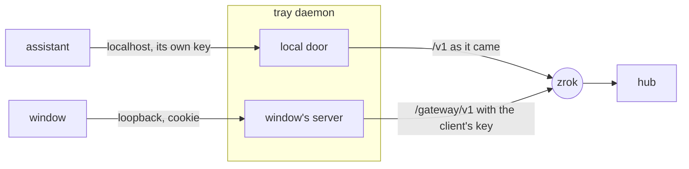

# Local Inference: The Desktop Client

*Third spec of the [local inference](roadmap/local-inference.md) epic, built on [the hub](local-inference-hub.md) and [the harness](local-inference-harness.md). Its work order will be `local-inference-client-work-order.md`. Every call that was marked **(proposed)** in its first draft has since been ruled on by Michael in the design session, and none remains.*

## What This Is

The hub spec taught the gateway to know its lab, and the harness spec let its owner operate it. Both stop at the hub's door. This spec is what a person installs to come through that door from wherever they are.

The client is a small desktop program that lives in the system tray. It does two things. It makes the lab's models appear on `localhost`, so an assistant on the same machine is given a local address and a key, as it would be for any API, and never learns about overlays. And it opens a window onto the hub: what is running where, what the traffic has been doing, and, for the owner, the controls.

It is, more or less, a dongle for the system it is installed on: it gives that system's user access to the inference infrastructure.

It is for everyone the lab is shared with, not only its owner. Someone running local inference installs the gateway where it belongs in their infrastructure and then hands out access, and each person they hand it to installs the client. The owner is one of those people, and at the owner's laptop the client acts as root. A guest runs the same program and sees less.

Being easy to use for someone who did not build the lab is a goal of the design, and several calls below follow from it.

## Why a Pass-Through

An earlier suggestion was to run the gateway itself on the laptop in a client configuration, with the hub as its only upstream. That was set aside for something much thinner. The client forwards requests to the hub as they came. It routes nothing, translates nothing, adds nothing, and keeps no usage records.

The reasons are about what a laptop is. The gateway treats an overlay it cannot reach at startup as a fatal error, which is right for a server someone is watching and wrong for a machine that wakes up on hotel wifi. And everything worth measuring about a request is already measured at the hub, where root can read it. A second gateway would measure the same traffic again, slightly differently.

What the thin shape gives up is a place to put opt-in hosted fallback. That stays deferred, and it is the thing that would bring a gateway engine into the client if it ever arrives.

## The Shape

The client is built on `dfw`, in its daemon-and-window form. A resident process shows the tray icon and owns everything that has to outlive a window. The window is a separate process that comes and goes.

The daemon holds two listeners, and they are separate on purpose.

The *local door* is what the assistant talks to. It sits on a fixed port so an assistant is configured once, it holds no key of its own, and it carries inference and nothing else.

The *window's server* is what the window talks to. It serves the client's own pages and carries status and control. It requires a cookie that only the client's windows hold.

The split follows from the cookie. An assistant cannot present one, so the door it uses cannot be the one that carries control.

Closing the window does not close the door. Quitting from the tray does.

## The Local Door

The door forwards requests under `/v1` to the hub and returns what the hub says. Anything else is refused there.

The key a request arrives with is passed through untouched, and the door adds none. An assistant is given the door's address and a key, exactly as it would be for any other API, and the hub decides what that key may do. A caller with no key, or a wrong one, gets the hub's refusal.

An earlier draft had the door put the client's own key on every request, so that an assistant needed only an address. That made the door a way to spend someone's key for anything that could reach the port, and it was reversed.

It binds to loopback only, and that is not configurable. The client serves the one machine it is installed on, and a door on the network would lend that machine's grant on the share to everyone around it.

It does not interpret what passes through. It reads no request body and no completion, so a route the hub gains later works through an old client without a change. But it does know a stream from a body, because a laptop's most common failure is a connection that dies halfway through an answer. A request that cannot be sent gets an ordinary OpenAI-shaped error. A stream that breaks after it has started is ended with an error event, as the gateway's own streams are, and not simply cut.

The door originates exactly one kind of error of its own: it could not reach the hub, and why. Every other error is the hub's and passes through untouched.

Nothing is retried anywhere else. The client has one upstream, and the epic's guarantee that nothing crosses from local to hosted on failure is kept here by there being nowhere to cross to.

## Connecting

### What gets handed out

For the example the hub serves on a persistent private zrok share, made once with zrok's own command, so its token survives a hub restart. zrok creates shares in closed permission mode unless told otherwise, and from this spec on so does the gateway when it creates one for itself. Reaching the hub therefore takes three things, and the owner supplies all of them:

- a grant on the share for the person's zrok account,
- the share's token,
- and a virtual key at whatever level the owner chooses.

The person brings a zrok account on the same zrok service, and nothing else. The client enables their machine with it. The first time it runs it asks for the account's token and does what zrok's own enable command does, and from then on the machine is enabled as if that command had been run. A machine that is already enabled is used as it is. Nobody installs a second program or opens a terminal.

The owner's own laptop needs no grant when it is enabled under the same zrok account as the hub. An account may always reach its own shares.

The client is set up by giving it the share's token and the key, and the zrok account's token where the machine is not yet enabled. It asks for them in its window the first time it runs. That key is the client's own, used for its window. An assistant is given a key separately, which may be the same one. It keeps the share's token and the key in a file only the account can read, beside its other settings. Someone who would rather skip the window can write that file by hand, and the client starts from it. Written by hand, it may name a plain URL in place of a share's token, for a hub on the same network. The setup page does not offer that. It does not keep the zrok account's token. zrok's own environment holds that, as it would after zrok's own command. Where the lab uses a zrok service of its own, the client is told that service's address as well. The setup page keeps that field out of sight, behind a link for people who run their own zrok, so most people never see it. A machine is enabled against one zrok service. If this one is already enabled on a different service, the client says so and changes nothing. One client talks to one hub.

### States

The client is always in exactly one of these, and the tray and the window both say which.

| State | Meaning |
|---|---|
| not set up | it has no token or key yet, or cannot read its settings |
| no zrok environment | this machine is not enabled with zrok, and the client has no account token that works |
| share not found | zrok does not know the token |
| not granted | the share exists and this account has not been granted access |
| connecting | reaching the hub, or reaching it again |
| hub unreachable | the share is there and nothing is answering behind it |
| key refused | the hub answered and does not accept the client's key |
| connected | the hub accepted the client's key, and the client knows its level |

The door works whenever the hub can be reached. In *key refused* it still carries requests, because each one brings its own key, and only the window has nothing to show.

Only one kind of thing stops the client from starting: it cannot open its own listeners, which is also how a second copy finds out that it is the second. Everything else on this list is a state it sits in, visibly, until it changes. A desktop program that exits with an error nobody sees has not reported anything.

zrok tells an account that lacks a grant apart from a token it does not recognize, so the client can tell a guest exactly what to ask the owner for.

### Staying connected

A laptop sleeps, changes networks, and wakes up somewhere else. The client is expected to come back by itself, without being restarted and without its settings being touched. It notices that it has been asleep and reconnects before anyone asks it for anything, where it can.

A request that arrives while the client is not connected does not hang. Within a few seconds it is either served, because the connection came back, or refused with a 503 that names the state.

Because the hub's share is persistent, a hub restart is only an interruption. The client goes to *hub unreachable* and returns when the hub does.

A client that is killed must not leave a growing pile of registrations behind at zrok. How it avoids that depends on what zrok does with them, which is one of the things to be tried first.

## Levels

The window takes the level of the client's key and shows what that level may see.

- With a **consumer** key it shows the door's address, the state of the connection, and the models that key may use.
- With a **read-only** key it also shows the lab: hosts, GPUs, engines and their states, models and whether they are servable, and the hub's history.
- With a **root** key it also shows the request feed and everything broken down by key, and has the controls.

What an assistant may do is decided by the key the assistant carries, which need not be the client's. An owner can keep root in the client for control and give their assistants a consumer key.

The client does not decide any of this. It asks the hub what its key is, and it draws whatever the hub sends. The hub leaves out what a level may not see, as the hub and harness specs already require, so a read-only window has no names in it because none arrived. Hiding a control is presentation. The hub's refusal is the gate.

The same holds for restrictions. The client never works out for itself which models a key may use. The hub tells it.

The client also keeps a short list of its own door's recent traffic: when a request came, which route, how it ended, and how long it took. It is held in memory, it is what can be known without reading a body, and it is the only view of their own requests a consumer has.

## Observing

The window is kept current by polling. The daemon asks the hub for its snapshot, its window of history, and, for root, the request feed, and the window asks the daemon. While a window is open this is frequent enough that an operation's progress is seen within a few seconds. With no window open the daemon keeps only a slow check that the hub is still there, so the tray stays truthful.

A pushed stream was considered and set aside. The hub itself learns about its hosts by polling, and a long-lived connection from a laptop is broken by every closed lid, so keeping one alive is polling with more parts.

The daemon relays the hub's status data to the page as it arrived and adds only what it alone knows: the state of the connection and the door's own traffic. The page does the drawing. That keeps one description of the lab in the system, the hub's, with the client as its reader.

It also means the page meets hubs it was not built against. A client is installed on someone's laptop and stays there while the hub is upgraded. So the page shows a state it does not recognize as the hub named it, ignores fields it does not know, and says so when the hub is newer than it is.

For root, the request feed is how the walk-through's third step is seen: each request, the host that served it, and its tokens, as the hub recorded them.

## Operating

Control exists in the window only for a root key. It is the harness spec's control, offered where it can be seen.

An engine can be started or stopped from its row. A stop shows the engine draining, then stopped.

A GPU can be claimed. The window offers a note, which is optional, and asks whether to wait out the host's grace period or take the GPU at once. Before the claim is sent it says what it will do: the engines that will stop, and any model the snapshot shows would be left with no engine. That warning is read from the snapshot and is only a warning. What actually happens is the hub's and the harness's to decide.

A held claim shows its age and what it stopped, and releasing it shows those engines come back through loading.

When the hub or a harness refuses something, the window shows the reason it gave, as given.

The tray carries no controls. Its menu is fixed when the daemon starts, and a lab's GPUs are not.

## Who May Reach What

The client's key never leaves the daemon. The page does not hold it, and it is never put on a request that came in through the door.

The window's server requires the cookie on every request. That closes it to a page in the user's browser, which can reach a loopback port and cannot have the cookie, and to another account on the same machine. Getting a secret into the window is something only `dfw` can do, so this is an addition to `dfw`.

The local door lends no key. A request goes to the hub with the key it arrived with, so anything that can reach the door, another account on the same machine included, still needs a key of its own that the hub accepts.

What the door does lend is the path, which is this machine's grant on the share. So it also refuses requests that are not addressed to localhost, and requests a browser makes on behalf of a page from somewhere else. That matters most for a hub that runs with keys turned off.

A process running as the user is not defended against. It can read the settings file, and nothing the client does would change that.

## Where It Lives and How It Ships

The client lives in this repository, on the epic's branch, as its own binary with its own release path.

It brings two things the gateway has never had: a native webview, which needs cgo and platform headers, and a web page with whatever toolchain builds it. Neither may leak into the server. The gateway's release builds stay cgo-free and link nothing of the client's. Someone who has never installed a webview header or a page toolchain can still build, test, and release the gateway. How that is arranged is the work order's to decide.

The first platforms are Linux and Windows. macOS comes later.

A webview build cannot be cross-compiled the way the gateway's are, so each platform's client is built on that platform. The client ships as a plain archive per platform, since `dfw` provides no packaging.

Like the other programs built on `dfw`, it carries two subcommands, `desktop integrate` and `desktop remove`, which add and take away its launcher and icons for the desktop the user is running. On Linux that is the house practice as it stands. On Windows it is new work, because the existing programs integrate with Linux desktops only.

It can also start at login, as a setting the user turns on. A dongle that is not running gives no access.

The window offers both as switches, so that someone who never opens a terminal can still have them.

What integration means on Windows, and how a subcommand reports there, is left for the work order to settle.

Where the client originates an OpenAI-shaped error, it uses the gateway's own wire types and error helpers. Nothing is declared twice.

## What the Hub Gains

Three things. Two are on the status surface, and the third is on its door.

**An answer to "what am I."** Any valid key, consumer included, may ask the hub its level, its name, which of the catalog's models it may use, and the hub's version. Without it a client could only find its level by being refused. This overlaps the carded per-key filtering of `/v1/models` and may be the occasion to build it.

**A request feed that can be read from a position.** A poller has to be able to ask for what is new since it last asked, so that it neither misses a request nor shows one twice.

**Closed shares of its own.** Every zrok share the gateway creates for itself is made in closed permission mode, public or private, as zrok's own commands make them. Today it asks for open, so anyone on the zrok service who learns an ephemeral share's token can reach the door, with the key as the only gate. The share's config gains a list of accounts to grant. Without one a closed share answers only its owner's account, and an ephemeral share's token does not live long enough to be granted by hand. Nothing turns a share open again. A share the gateway attaches to by token was not made by the gateway and is left as its creator made it.

## What dfw Gains

An optional cookie shared between a window and the server it is pointed at. `dfw` makes the secret, places it in the window, and itself refuses a request that arrives without it. It is carded in `dfw`'s own roadmap as *window cookie*, and its spec is drawn there as `docs/future/window-cookie.md`. The client depends on it, and nothing else here asks anything of `dfw`.

## What Changes for Existing Deployments

One behavior changes, and it wants a changelog entry.

A zrok share the gateway creates is closed, where it used to be open. A caller that reaches an ephemeral gateway share from a different zrok account is refused until that account is listed in the share's grants.

## What Has To Be Tried First

Five things this design leans on have been read about and not tried. The work order should settle them before anything is built on top.

- Enabling a machine from the client. zrok's own command calls the service, saves the environment, and saves an identity. The SDK's own enable call expects an environment that already holds the account's token, so it does not do this for a machine that has never been enabled. If the SDK is the better home for it, the SDK can be amended.
- What a single zrok access does across a suspend, a resume, and a change of network: what recovers by itself, and how long the first request waits.
- What a killed client leaves registered at zrok, and whether a remembered registration can be used again or has to be removed at the next start.
- `dfw` as a tray daemon on Windows. Its own continuous integration builds Linux and macOS, and Windows has been checked by hand.
- `dfw` built against the version of `df` this repository uses. It was written against an earlier one.

## Scenarios

**The owner, away from home.** The client is already set up with the hub's token and the owner's key. The laptop opens on another network. The tray shows connecting, then connected. The assistant, given the door's address and a key on the day it was installed, just works. Nothing on the laptop was started by hand.

**A guest is given access.** The owner grants the guest's zrok account on the share, adds a read-only key restricted to one model, and sends the token and the key. The guest installs the client and pastes in three things: their zrok account's token, the share's token, and the key. They give their assistant the door's address and the same key. The window shows the four hosts, their engines, and which models are servable. It shows no names and no controls, and it marks the one model the key may use.

**The grant was forgotten.** The guest pastes the token and the key and the client shows *not granted*. It says the share exists and the owner has to grant this account. The owner adds the grant and the client connects on its next try. Nobody restarted anything.

**A request, seen from both ends.** The assistant asks for `qwen3.8-27b`. The door forwards it and the answer streams back. In the owner's window the request appears in the feed with the host that served it, its tokens, and its timing. In a consumer's window it appears in the door's own list, with a route, a result, and a duration.

**Claiming the 5090 from a café.** The owner chooses the 5090 and claims it, with a note and the host's grace. The window warns that one engine will stop and that `qwen3.8-27b` keeps its other engine. Within a few seconds the engine shows draining, and then the GPU shows claimed. Requests through the door keep being served, now by the 3090. Later the owner releases it and watches the engine load and come ready.

**Someone claimed it at the machine.** The owner is away and someone at home runs the harness's claim command on the 4090. A few seconds later the owner's window shows the claim, who made it, and why. A guest's window shows that the GPU is claimed and since when.

**The lid closes mid-answer.** A stream is half delivered when the laptop sleeps. The assistant's connection ends. On waking, the client notices the gap and reconnects. The assistant's next request is served. Had it come a moment too early it would have had a 503 saying the client was still connecting, within seconds, and not a hang.

**The hub restarts.** The hub is restarted to add a key. Clients show *hub unreachable*, and then *connected* again without anyone touching them, because the share's token did not change. The owner's window shows an empty history, since the hub's window is lost on restart.

**A hub on a share of its own.** Someone tries the gateway out on a share it creates at startup, and lists a colleague's zrok account in its config. The colleague's client connects with the token from the log. Someone else who sees that token and tries it gets *not granted*.

**Someone else on the same machine.** A second person logged into the same workstation points their assistant at the door. With no key of their own, the hub refuses them. With a key the owner gave them, they are served under that key. Either way nothing was spent on the key of the person who installed the client.

**A mistyped key.** An assistant is given a key with a character missing. The hub's refusal comes back through the door as it would from any API, and the door's own list shows the request and how it ended.

**A page tries the door.** A web page open in the laptop's browser sends a completion to the local door's port. The door sees a request made on behalf of a page from somewhere else and refuses it. The same page trying the window's server has no cookie and is refused there too.

**A newer hub.** The hub is upgraded and an engine now reports a state the client has never heard of. The window shows the state by the name the hub gave it, and a line saying the hub is newer than the client.

**A control that was never offered.** A guest crafts a claim request by hand. The local door does not carry it. The window's server will not take it without the cookie. Sent straight to the hub with the guest's key, it is refused. The client hid the control, and the hub is what stopped it.

## Seam Census

Each line is a boundary, the call, why, and what would reopen it.

- **The local door and the window's server.** Separate. The assistant's door carries inference only and holds no key, and status and control ride a listener that requires the cookie. Nothing foreseeable reopens this.
- **The door and credentials.** The door adds none. A caller's key passes through, and the hub is the only thing that judges it. An earlier draft attached the client's key, which let anything that could reach the door spend it. Reopen only as something the user turns on for a machine they alone use.
- **Level, and who enforces it.** The hub, alone. The client asks what it is and draws what it is sent. A client-side check that something relied on would be a second gate that can disagree with the first.
- **Status data and its rendering.** Separate, as the hub spec has it, and extended here: the daemon relays the hub's data unreshaped and the page draws it. The daemon formats nothing, and adds no layer of transformation of its own. Reopen if the page needs something no single hub response holds.
- **The page and everything behind the daemon.** Separate. The page knows nothing of zrok, the hub's address, or the key. It talks to the window's server and to nothing else. The window's server is a second gateway-native surface, so the boundary statement the hub spec asks of `openai-front-door` covers it too.
- **The transport to the hub.** One seam with one overlay built. zrok is carried in the HTTP client's transport and never in a URL, as `overlay-in-the-transport` already requires of the gateway. A plain URL is also accepted, in the hand-written settings file only, for a hub on the same network and for testing without an overlay. Raw ziti joins here when its spec is drawn.
- **Interpreting what passes through the door.** Not done. The door frames a stream so that it can end one honestly, which is what `stream-integrity` asks, and it reads nothing else. Reopen with hosted fallback, which has to understand a request.
- **OpenAI wire types.** One copy. The door's own errors use the gateway's types and helpers, as `openai-front-door` requires of every OpenAI-shaped surface in the repository.
- **Client and hub versions.** Loose. `/gateway/v1` is the contract, and the client tolerates what it does not recognize. Reopen when a hub change cannot be made compatibly, which is what a second version of the prefix is for.
- **Errors by tier.** At start, a listener that cannot be opened ends the process with a directed error. Everything about settings, zrok, and the hub is a state the client holds and shows, never an exit. That is the opposite of what `explicit-config-fails-loud` asks of the gateway at boot, so that quality needs a statement that the client reports in its window instead. That edit is Michael's, in terminus-canon. On the door, the client's own failure is an OpenAI-shaped 503 naming the state, and a hub error passes through untouched. In the polling loop a failure changes the state, is logged, and the loop continues. On the control path a refusal is shown with the reason it came with.
- **The client's build and the gateway's.** Separate, in one repository. Nothing native and no page toolchain reaches the server's build, test, or release.
- **One client, one hub.** Fused, to start. Reopen when someone has access to two labs.

## Deferred (and Why)

- **macOS.** `dfw` is furthest along on Linux and Windows, and a macOS application needs a signed bundle.
- **Installers, signing, and updating itself.** `dfw` ships no packaging, and each of these is its own piece of work on each platform. Until then the client is an archive the user unpacks, with `desktop integrate` to give it a launcher. They are the first thing to do before the client goes to guests in numbers.
- **The operating system's keychain.** The key is kept in a file only the account can read, which is how zrok keeps its own account token. A keychain would be stronger, and it is separate work on each platform.
- **One invitation instead of a token and a key.** A single thing to paste would be kinder. It needs a format, and care about where a string holding a credential ends up.
- **Handing out keys from the window.** The owner still adds keys in the hub's config or its key source. The harness spec defers control of the hub's own state until the hub has a store, and this waits with it.
- **A door on the network.** The door is loopback only, to start. Serving other devices through one laptop would lend this machine's grant on the share to that network, and it is not what a dongle for one system is for.
- **An assistant that needs no key.** The door could attach the client's key for a caller that brings none, so an assistant needs only an address. That was the first design. It was reversed because it lets anything that reaches the door spend that key, and it could come back only as something the user turns on for a machine they alone use.
- **Browser-based assistants.** A page calling the door from a browser needs cross-origin permission the door does not give.
- **Opt-in hosted fallback.** Unchanged from the epic. It is what would bring a gateway engine into the client.
- **History kept on the laptop.** The door's list is in memory and the hub's window is the hub's. A persistent store is deferred there and here.
- **Pushed status.** Polling is enough.
- **Controls in the tray, and desktop notifications.** The tray's menu is fixed at startup. A notification when a claim completes would be pleasant and proves nothing.
- **Several hubs.** One client, one hub, until someone needs two.
- **Raw ziti.** Its own spec, last.
- **Engine logs.** Deferred in the harness spec. The window would be their natural reader.
