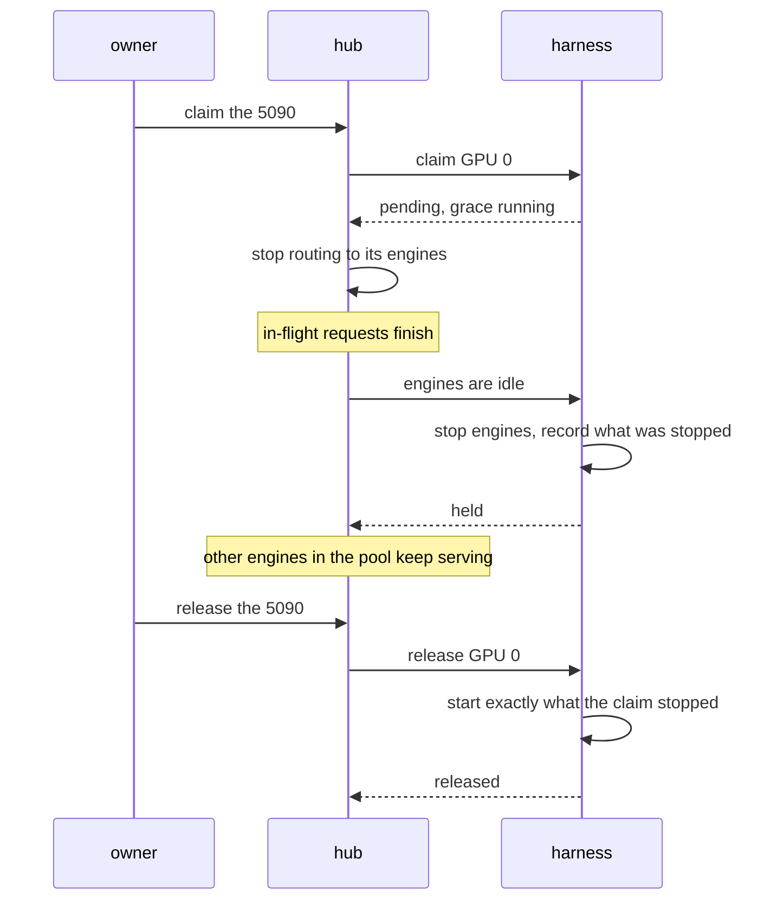

# Local Inference: Harness and Control

*Second spec of the [local inference](roadmap/local-inference.md) epic, built on [the hub](local-inference-hub.md). Its work order will be `local-inference-harness-work-order.md`. Calls marked **(proposed)** are the design agent's and have not yet been confirmed by Michael; everything else was decided in the design session.*

## What This Is

The hub spec taught the gateway to know its lab. This one lets the owner operate it.

Two things are added. A *harness* is a small process on each inference host that can start and stop the engines declared to it and report what the host's GPUs are doing. And *control* is what the hub offers a root key on top of that: start an engine, stop one, claim a GPU for something else, release it.

The reason this exists is specific. Engines in this lab are stopped whenever a user-facing application needs a GPU, and today that means SSH and `systemctl --user` on the right host. The owner wants to say "I need the 5090" from wherever they are, and have inference adapt in a reasonable way.

## Why a Harness, and Why This Small

The operation being automated is starting and stopping a service. That makes the control dialect systemd, not the API of any inference server, and it means one harness covers vLLM and a custom engine alike. Nothing here needs to know how an engine loads a model. Loading is what starting it does.

The alternative was the hub reaching into hosts over SSH and running the same commands. It needs nothing installed on the hosts, and it was set aside for two reasons. It puts a credential with shell reach on the hub. And it leaves host statistics with no natural home.

The harness is deliberately narrow. It knows only the engines its own config declares. The hub sends it a name and a verb and never a command, so the list of what may be done on a host lives on that host, written by whoever owns it. Nothing in a request reaches a shell.

It also stays out of the inference path. The hub goes on dialing engines directly, exactly as the hub spec describes. If a harness dies, control and host statistics for that host go dark and inference carries on.

## Engines, Hosts, and Where Each Is Declared

An *engine* is a named thing on a host that serves models while it runs. To the harness it is one or more systemd user units and the GPUs they occupy:

```yaml
# harness config on box-5090
listen: "10.0.0.50:8090"
token: "${HARNESS_TOKEN}"
engines:
  - name: qwen
    units: ["qwen-engine.service"]
    gpus: [0]
```

An engine that omits `gpus` is taken to occupy every GPU on its host, so any claim there stops it. **(proposed)**

The hub declares which harnesses exist and which endpoint each engine stands behind:

```yaml
# hub config
harnesses:
  - name: box-5090
    base_url: "http://10.0.0.50:8090"
    token: "${BOX_5090_HARNESS_TOKEN}"

providers:
  local:
    endpoints:
      - name: box-5090
        base_url: "http://10.0.0.50:9000"
        weight: 3
        models: ["qwen3.8-27b"]
        harness: box-5090
        engine: qwen
```

The division is deliberate. The hub's config says what the lab *is*: its endpoints, and which engine is behind each. A harness's config says what may be *done* on its host. Neither repeats the other. **(proposed)**

An endpoint linked to an engine must declare its `models`. Discovery only works while an engine runs, and the hub has to know what a stopped engine would serve. **(proposed)**

An engine needs no endpoint. Whisper on the 2080ti has no route through the gateway, but declared to its harness it can still be seen, stopped, started, and claimed around.

Systemd stays inside the harness. The hub, the status surface, and every reader speak of engines and their states and never of units.

The hub dials each harness, the way it dials an endpoint, and a harness can be reached by any transport an endpoint can. The two share a token. On a LAN that token travels over plain HTTP, as inference already does; anything off the LAN belongs on the overlay. **(proposed)**

The harness is a mode of the same binary, run as a user unit of the account that owns the engines, so `systemctl --user` simply works. **(proposed)**

## What the Harness Reports

The hub asks each harness for its state often enough that a claim made at the machine is noticed within a few seconds.

For each GPU the harness reports its name, memory in use and in total, and utilization. It also reports the memory held by processes that are not its declared engines, so "something else is using this GPU" is visible even when nobody has claimed it.

For each engine it reports the state, when it last changed, and who changed it and why. For each claim it reports what is described below.

GPU reporting is NVIDIA-only to begin with. An engine on any other hardware is still controllable; its GPU simply reports nothing.

Joined with what the hub already knows about the endpoint, an engine is in one of these states:

| State | Meaning |
|---|---|
| ready | running, and its endpoint is answering |
| loading | running, and has not answered yet since it was started |
| unresponsive | running, had been answering, and no longer is |
| draining | still running, and being sent no new requests |
| stopped | not running, and nothing is wrong |
| claimed | stopped because a GPU it occupies is claimed |
| failed | the service manager reports that it failed |

This is the distinction the hub spec could not make. A stopped engine and a failed one both look merely unhealthy to a probe; the harness knows which it is.

An endpoint with no engine behind it keeps the hub spec's two states.

## Start and Stop

A root key may ask the hub to start or stop an engine.

A start goes to the harness, which refuses it if any GPU the engine occupies is claimed. Otherwise the units are started and the engine is *loading* until its endpoint answers, at which point it joins its model's pool. The hub probes a freshly started engine promptly instead of waiting out a backoff earned while it was stopped.

A stop is coordinated by the hub, because only the hub can see requests in flight. The engine goes to *draining* and is sent nothing new. When its in-flight requests finish, or a grace period ends, the hub asks the harness to stop it.

Every start and stop carries who asked and why, and the harness records both. That is useful to read, and it is also the hook the deferred standby behavior needs.

Whether there is enough free memory to start an engine is not checked. The owner can see the GPU's memory and decide.

## Claims

A claim says: this GPU is wanted for something else, so keep inference off it until it is released.

**The host owns the claim.** It is created at the harness, stored on the host, and enforced there. The hub asks for claims and reflects them, and holds no claim state of its own. Three things follow. A claim survives a hub restart. A claim can be made at the machine itself, with no hub and no client. And the host enforces it: the harness will not start anything on a claimed GPU, whoever asks.

A claim has one life, however it begins.



It starts *pending*, with a grace period the harness owns. As soon as the hub learns of a pending claim it stops routing to the engines on that GPU. When they go idle the hub says so, and the harness proceeds early. When the grace ends the harness stops them regardless, and any request still in flight is cut. A claim may also be made with no grace at all.

A claim made at the machine follows the same path. The hub was never asked; it notices the pending claim the next time it reads the harness's state, and cooperates from there. If the hub is down, the grace simply runs out. **(proposed)**

Once the engines are stopped the claim is *held*. The harness records which engines it stopped. Engines that were already stopped are not part of the claim.

While it is held, routing adapts through the catalog and nothing else. A model with another running engine keeps working with no visible change. A model left with no engine fails fast, with a 503 that says its GPU is claimed and since when.

Release restarts exactly the engines the claim stopped and nothing else. They come back through *loading* and rejoin their pools when they answer. An engine that fails to start on release is reported as failed; the claim is still released.

A second claim on a claimed GPU is refused. A claim on a GPU with nothing running is allowed, and simply reserves it.

**Enforcement has edges, and they are chosen.** The harness enforces a claim when it is asked to start something, and when the harness itself starts. The second matters after a reboot, when systemd may bring enabled engines back up on a GPU that is still claimed; the harness stops them. But it does not police the machine in between. If someone starts an engine by hand on a claimed GPU, the harness reports the conflict and leaves it running. A person at the machine outranks the harness. **(proposed)**

If an engine will not stop, the claim is held anyway and the conflict is reported. The GPU is not actually free, and the status says so.

## Who May Do What

Control needs a root key. With authentication disabled there is no root, and so no control at all.

A read-only key sees hosts, GPUs, engines, their states, and that a GPU is claimed and since when. It does not see who claimed it, the note, or who started and stopped what; those name people, and names stay with root, as in the hub spec. A consumer whose model is unavailable is told that the GPU is claimed and since when, and no more. **(proposed)**

At the machine, anyone who can run the harness's own command as the engine-owning account may claim and release. Being logged in as that account is its own authority.

Every control action is logged with who took it and what came of it, and the recent ones are readable by root on the status surface.

Control rides the same door as inference, as decided. The condition recorded for reopening that was root offered over a public share, and control is where it bites. So a gateway with any harness configured refuses to start with a public zrok share enabled. **(proposed)**

## What the Status Surface Gains

The snapshot gains hosts as first-class things: each harness with its reachability, its GPUs, its engines and their states, and its claims. Endpoints gain the richer states above. The window gains GPU utilization and memory per GPU. Root gains the log of recent control actions.

A harness that cannot be reached is shown as unreachable. Its engines' states become unknown, their endpoints fall back to the hub spec's plain health, control for that host fails with a clear error, and inference is untouched.

## Scenarios

**Claim the 5090 from away.** The owner needs the 5090 for a user-facing application. A root request claims it. The hub stops routing to that host's engine, a stream in flight finishes, the engine stops, and the claim is held. Requests for `qwen3.8-27b` are now all served by the 3090. The snapshot shows the 5090's GPU claimed and its engine in the claimed state.

**Release.** The application is done. Release starts the engine; it shows as loading while the model comes up, then ready, and the pool is two again.

**Claim at the machine.** Sitting at the 5090, the owner runs the harness's claim command with a note. The hub was not asked. Within a few seconds it sees the pending claim and stops routing there, and the same path plays out.

**The claim takes the last engine.** The 3090's engine was already stopped when the 5090 is claimed. `qwen3.8-27b` now has no engine. Requests for it get a 503 at once, saying the GPU is claimed and since when. With standby engines this is where the 4090 would start; that is deferred.

**The hub restarts during a claim.** The hub comes back knowing nothing. It reads the harness, finds the claim held, and shows it. Nothing starts on the 5090.

**A start that the claim refuses.** A root request asks to start the engine on the claimed 5090. The harness refuses and names the claim. The owner releases first, or leaves it.

**Bringing up the 4090.** An engine and its endpoint are declared for the idle 4090. A root request starts it. It shows as loading, then ready, and its model appears in the catalog as servable.

**Something else has the GPU.** No claim is held, but a process outside the declared engines is holding most of the 3090's memory. The snapshot shows that memory as in use by something else, which is the first thing the owner needs to know before starting anything there.

## Seam Census

Each line is a boundary, the call, why, and what would reopen it.

- **Names and verbs, never commands.** Enforced. The harness acts only on engines and GPUs its own config declares, and nothing from a request reaches a shell. This is the property that makes it safe to install. Nothing foreseeable reopens it.
- **The harness and the inference path.** Separate. The hub dials engines directly; the harness only controls and reports, so its failure cannot take inference down. Reopen if a host must be reached through a single overlay share for both.
- **Who owns a claim.** The host. The hub requests and reflects, and holds no claim state. Nothing foreseeable reopens it.
- **Who owns the grace period.** The harness, with the hub cooperating by reporting idleness. One mechanism then serves claims from the hub and claims at the machine. **(proposed)**
- **Systemd and everything above it.** Separate. Unit names never leave the harness. Reopen when a second way of running engines appears: system units, containers, another service manager.
- **What the lab is, and what may be done to it.** Separate. Topology is the hub's config; permission is each harness's. **(proposed)**
- **Harness wire types and the model behind them.** Separate, and bound with `dd` from the start, as the hub spec decides for its own surface. **(proposed)**
- **Enforcement of a claim.** At a start request and at harness startup; reported, not enforced, against a person at the machine. **(proposed)**
- **Errors by tier.** At boot, the hub refuses an endpoint that names an unknown harness or a linked endpoint with no declared models, and a harness refuses a declared unit that does not exist. On the control path, a refused or failed verb is an error to the caller that names the reason, and never ends either process. In the polling loop, an unreachable harness is logged and shown, and the loop continues. On the inference path, a harness failure changes nothing.
- **One door, and public shares.** Control rides the inference door at root level. A gateway with a harness configured refuses a public share. **(proposed)** Reopen when someone needs both, which is when a separate control door earns its place.

## Deferred (and Why)

- **Standby engines.** An engine that starts when a claim removes capacity and stops on release. Wanted, and designed for: every start and stop already records who and why, which is what a restarted hub would need to undo a standby it had started. Not built until the plain claim has been lived with.
- **Starting an engine because a request arrived for its model.** It would take a GPU that a user-facing application may be using. A claim makes it safer but does not make it safe by default.
- **Claiming automatically when an application launches.** It needs the harness to know about applications, which it does not.
- **Refusing a start for lack of memory, and placement by fit.** The harness cannot know what an engine needs until it has run. The owner can see the memory.
- **Claims that expire or are scheduled.** A forgotten claim is a real hazard. For now its age is shown plainly.
- **Other ways of running engines.** System units, containers, launchd, Windows services. The lab is systemd user units throughout.
- **GPU reporting beyond NVIDIA.**
- **A harness that dials the hub.** It would reach hosts behind NAT without an overlay, at the cost of an inbound door and harness identity on the hub. The hub dials.
- **Stronger authentication between hub and harness.** A shared token is enough on a LAN that already carries unauthenticated inference.
- **Control of the hub's own state.** Taking an unlinked endpoint out of rotation, changing weights, managing keys. The hub keeps no persistent state, so anything set there would be silently undone by a restart. It waits for a store.
- **Engine logs.** Reading a failed engine's output from the client would be useful. It widens what the harness may read on a host, and can follow.
- **A restart verb.** Stop and start compose it.
